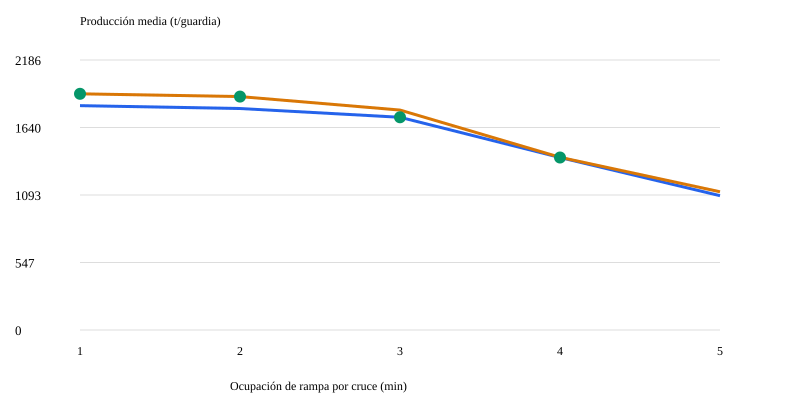

# MineFleet — Underground Haulage Optimization
[](https://github.com/martinklinger05-dev/minefleet-underground/actions/workflows/tests.yml)

**[Ver panel de resultados](https://martinklinger05-dev.github.io/minefleet-underground/results/dashboard.html)** — Resultados del escenario simulado, disponibles sin instalar Python.

Proyecto de portafolio de Martin Klinger Castillo · Ingeniería de Minas.

Simulador en Python de acarreo subterráneo y selección exhaustiva de asignaciones estáticas de volquetes. **Todos los datos y resultados incluidos son simulados.** Primera versión funcional; no es un sistema de despacho operacional ni una tesis validada.

## Resultado reproducible

Escenario de seis volquetes, dos frentes y una descarga; 30 réplicas por distribución.

| Indicador | Base: A=3, B=3 | Seleccionada: A=4, B=2 |
|---|---:|---:|
| Producción media (t/guardia) | 1793.33 | 1890.00 |
| Desviación estándar (t) | 13.02 | 14.08 |
| Costo supuesto (S/ por t) | 3.764 | 3.571 |
| Espera acumulada de la flota (min/guardia) | 162.23 | 159.95 |

Incremento de producción simulada: **5.39%**. La asignación 5/1 produce más toneladas totales, pero incumple la meta de 500 t medias del frente B. La selección es la mejor entre las siete asignaciones evaluadas que cumplen ambas metas medias. No garantiza el cumplimiento en cada réplica ni una mejora real en una mina.

## Ejecutar

Requiere Python 3.10 o superior. No necesita paquetes externos.

```bash
python minefleet.py
python -m unittest discover -s tests -v
```

Abrir `results/dashboard.html` en el navegador. Para servirlo localmente:

```bash
python -m http.server 8000 --directory results
```

Visitar http://localhost:8000/dashboard.html. Este panel presenta resultados; modificar `data/scenario.json` y ejecutar nuevamente para comparar otro escenario.

```bash
python minefleet.py --scenario data/scenario.json --out results
```

## Modelo de ingeniería

Cada volquete sigue: carguío → cruce de rampa cargado → resto del viaje cargado → descarga → cruce de rampa vacío → resto del retorno → carguío.

- Un recurso de carguío por frente, capacidad 1.
- Una descarga compartida, capacidad 1.
- Un tramo de rampa compartido, capacidad 1 en ambos sentidos.
- Colas FIFO según llegada; empate resuelto por orden de inserción del evento.
- Tiempos de carguío, descarga y viajes restantes con distribución triangular ±15% del valor nominal.
- Cruce fijo de 2 min, incluido dentro de los tiempos nominales de viaje; no se agrega de nuevo.
- Las esperas se generan por contención de recursos; no se añade una espera fija de 5 o 7 min.
- Inicio: todos los equipos vacíos y disponibles en su frente a tiempo cero.
- Solo cuentan cargas cuya descarga termina antes o exactamente al minuto 450. No se exige terminar el retorno para contabilizar mineral entregado.

Esta convención difiere del ejercicio inicial basado en ciclos completos. Los seis equipos se mantienen asignados durante toda la guardia; no hay despacho dinámico.

## Optimización y costos

Se enumeran n_A=0,…,6 y n_B=6−n_A. Se maximiza la producción media simulada, sujeta a metas medias por frente y rutas habilitadas. Cada opción usa las mismas semillas de réplica y flujos aleatorios independientes por equipo; la reasignación cambia la secuencia de eventos, por lo que esto no implica emparejamiento perfecto de ciclos entre opciones.

Costo de guardia = número de equipos × horas disponibles × costo por hora. El costo por tonelada publicado es costo fijo de guardia dividido entre producción media. Se supone S/150 por equipo-hora y se pagan los seis equipos durante las 7.5 h. Es un supuesto comparativo, no una estimación integral: no incluye desglose de combustible, mantenimiento, cargadores ni infraestructura.

## Archivos

- `minefleet.py`: simulación, evaluación, búsqueda y exportación.
- `data/scenario.json`: supuestos editables, unidades en minutos, toneladas y soles.
- `results/summary.json`: estadísticas y todas las alternativas.
- `results/events.csv`: trazabilidad de una réplica de la opción seleccionada. Puede incluir servicios programados más allá del cierre; esas descargas no cuentan.
- `results/dashboard.html`: panel autónomo.
- `tests/test_simulation.py`: ocho pruebas de invariantes y cálculo manual.
- `.github/workflows/tests.yml`: configuración para pruebas automáticas en GitHub.

## Verificación y límites

Pruebas locales: 8/8 aprobadas. Se verifica exclusión temporal de recursos, cantidad entregada, corte de guardia, reproducibilidad, restricciones, datos inválidos, caso sin solución y selección exhaustiva. Caso manual de un solo volquete: primera descarga en 21 min; siguientes cada 30 min; 15 viajes entregados = 375 t en 450 min.

Pendientes para una aplicación real: calibración con registros autorizados, validación independiente, distribución empírica de tiempos, fallas, cambios de guardia, geometría y pendientes, múltiples cruces, prioridades de tránsito, restricciones de ventilación, heterogeneidad de equipos y costos detallados. La rampa es un recurso abstracto ubicado antes del resto del viaje en ambos sentidos; no representa la geometría de una ruta específica. No equivale a una evaluación de seguridad.

La selección usa las mismas réplicas para elegir y reportar resultados; puede presentar sesgo de selección. Para tesis, separar réplicas de evaluación fuera de muestra, analizar incertidumbre y sensibilidad y validar contra una operación real. Los 30 escenarios por opción son una demostración, no un tamaño muestral científicamente justificado.

## Publicar en GitHub

Crear un repositorio llamado `minefleet-underground`, extraer este paquete y subir su contenido (README y minefleet.py deben quedar en la raíz). No subir datos empresariales confidenciales.

Descripción sugerida: "Underground mining haulage simulator in Python: discrete-event queues, static fleet allocation, reproducible experiments and operating cost comparison."

Este paquete no está publicado todavía. La automatización incluida se ejecutará cuando se suba a GitHub; únicamente se han ejecutado las pruebas locales en el entorno disponible.

## Explicación para una entrevista

«El proyecto representa la competencia de los volquetes por carguío, rampa y descarga con eventos discretos. Evalúa cada distribución y selecciona la de mayor producción media que cumple las metas por frente. Con datos simulados, pasar de 3/3 a 4/2 incrementó 5.39% la producción media. El resultado depende de los supuestos y requiere calibración antes de aplicarlo en campo».

Proyecto desarrollado con asistencia de IA. Para presentarlo como evidencia de competencias propias, revisa y ejecuta el código y asegúrate de poder explicar el modelo, sus supuestos y sus límites.

## Sensibilidad al tiempo de cruce de rampa

Se comparó el escenario original con otro en el que `ramp_crossing_min` aumenta de 2 a 3 minutos. Los demás parámetros se mantienen iguales: seis volquetes, 30 réplicas por asignación, semilla 2026 y metas medias de 500 t por frente.

| Indicador | Rampa de 2 min | Rampa de 3 min |
|---|---:|---:|
| Producción media con A=3, B=3 (t/guardia) | 1793,33 | 1722,50 |
| Producción media con A=4, B=2 (t/guardia) | 1890,00 | 1780,83 |
| Asignación seleccionada A/B | 4/2 | 3/3 |

Con la asignación fija 3/3, la producción media disminuye un 3,95 %. En el escenario de rampa lenta, la asignación 4/2 produce más toneladas totales que 3/3, pero el frente B alcanza solo 485 t medias y no cumple su meta de 500 t. Por ello, el modelo selecciona 3/3.

La comparación muestra que la selección de flota depende tanto de la producción total como de las metas de cada frente. Son resultados simulados; el cumplimiento de las metas medias no garantiza su cumplimiento en cada guardia.

### Reproducir el escenario

```bash
python minefleet.py --scenario data/scenario_rampa_lenta.json --out results_rampa_lenta
```

[Ver panel de rampa lenta](https://martinklinger05-dev.github.io/minefleet-underground/results_rampa_lenta/dashboard.html)

[Consultar resultados completos](results_rampa_lenta/summary.json)

## Comparación automática de ocupación de rampa

Se evaluaron cinco tiempos de ocupación de rampa, de 1 a 5 minutos, con 30 réplicas por distribución y semilla 2026.



| Ocupación por cruce | Selección A/B | Producción media (t/guardia) |
|---|---|---:|
| 1 min | 4/2 | 1912,50 |
| 2 min | 4/2 | 1890,00 |
| 3 min | 3/3 | 1722,50 |
| 4 min | 3/3 | 1396,67 |
| 5 min | Ninguna cumple ambas metas medias | — |

El tiempo total de viaje permanece fijo: aumenta la ocupación del recurso compartido y cambian las esperas. Los puntos verdes representan la distribución seleccionada entre las que cumplen las metas medias de ambos frentes.

Todos los datos son simulados. Cumplir las metas medias no garantiza cumplirlas en cada guardia.

### Reproducir el análisis

```bash
python sensitivity.py
```

[Ver panel de sensibilidad](https://martinklinger05-dev.github.io/minefleet-underground/results_sensitivity/dashboard.html)

## Cumplimiento de metas por guardia

Se simularon 1000 guardias por distribución y escenario, con metas de 500 t por frente y semilla inicial 2026.

| Rampa | Distribución A/B | Producción media (t/guardia) | Guardias con ambas metas |
|---|---|---:|---:|
| 2 min | 3/3 | 1796,10 | 1000/1000 |
| 2 min | 4/2 | 1889,65 | 996/1000 |
| 3 min | 3/3 | 1719,40 | 1000/1000 |
| 3 min | 4/2 | 1781,17 | 462/1000 |

Con rampa de 2 minutos, la distribución 4/2 cumple ambas metas en el 99,6 % de las guardias simuladas, pero el frente B promedia 499,90 t y queda ligeramente por debajo de su meta media. Esto muestra que la selección anterior, basada en 30 réplicas, estaba cerca del límite y es sensible al muestreo.

Con rampa de 3 minutos, el cumplimiento conjunto de 4/2 baja al 46,2 %. La distribución 3/3 cumple ambas metas en las 1000 guardias simuladas de cada escenario.

El panel incluye intervalos Wilson del 95 % para las frecuencias conjuntas. Un resultado observado de 1000/1000 no garantiza cumplimiento futuro. Los intervalos cuantifican incertidumbre de muestreo bajo el modelo, no su validez operacional.

### Reproducir el análisis

```bash
python reliability.py
```

[Ver panel de cumplimiento por guardia](https://martinklinger05-dev.github.io/minefleet-underground/results_reliability/dashboard.html)
